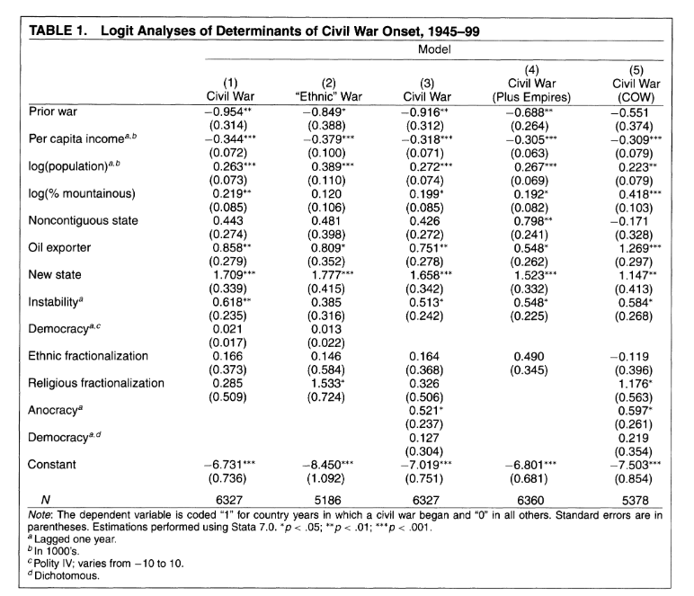

```{r}
#| label: setup

library(tidyverse)
library(broom)
library(peacesciencer)
```

# Multiple Logistic Regression

## Multiple Logistic Regression

<br>

::: {.incremental}
- Just as with linear models, we can also run multiple logistic regressions
- We can include multiple predictors in the model
- Usually we want to include our main predictor of interest and control variables
- The interpetation of the coefficients is the same as in the bivariate models
:::

## 

<br>

Download the data using the `peacesciencer` package if you haven't already...

<br>

```{r}
#| label: conflict_df
#| echo: true

conflict_df <- create_stateyears(system = 'gw') |>
  filter(year %in% c(1946:1999)) |>
  add_ucdp_acd(type=c("intrastate"), only_wars = FALSE) |>
  add_democracy() |>
  add_creg_fractionalization() |>
  add_sdp_gdp() |>
  add_rugged_terrain()
```

## 

<br>

Example, including multiple predictors associated with conflict:

```{r}
#| label: multivariate_model
#| echo: true

conflict_model <- glm(ucdponset ~ ethfrac + relfrac + v2x_polyarchy +
                        rugged + wbgdppc2011est + wbpopest,
                      data = conflict_df,
                      family = "binomial")

tidy(conflict_model)
```

## Predicted Probabilities

<br>

```{r}
#| label: marginal_effects
#| echo: true
#| code-fold: true
#| code-summary: "Show the code"

# load the 
library(marginaleffects)

# seledct some countries for a given year
selected_countries <- conflict_df |>
  filter(
    gw_name %in% c("United States of America", "Venezuela", "Rwanda"),
    year == 1999)

# calculate margins for the subset
marg_effects <- predictions(conflict_model, newdata = selected_countries)

# tidy the results
tidy(marg_effects) |>
  select(estimate, p.value, conf.low, conf.high, gw_name)
```

## Your Turn! 

<br>

- Run a multivariate logistic model using conflict onset as the outcome variable
- Select alternative variables and/or alternative measures of the same variables
- Interpret some of the coefficients 
- Calculate the precicted probability in a handful of country-years based on your analysis

```{r}
#| label: time1

library(countdown)

countdown(minutes = 10, 
          id = "timer1", 
          bottom = "5%", 
          right = "10%",
          color_border = "#fff",
          color_text = "#fff",
          color_running_background = "#42affa",
          color_running_text = "black",
          color_finished_background = "#E5D19D",
          color_finished_text = "#00264A")
```

# Regression Tables

## What's in a Regression Table?

{fig-align=center}

## Regression Tables with `modelsummary`

<br>

::: {.incremental}
- Oftentimes we want to show multiple models at once (like F&L)
- We want to compare across them and see which is the best model
- How can we do that? 
- There are **many** ways to do this in R
- We will use the `modelsummary` package
:::

## Run Multiple Models

<br>

```{r}
#| label: multiple_models
#| echo: true

ethnicity <- glm(ucdponset ~ ethfrac + relfrac + wbgdppc2011est + wbpopest, # store each model in an object
                  data = conflict_df,
                  family = "binomial")

democracy <- glm(ucdponset ~ v2x_polyarchy + wbgdppc2011est +  wbpopest,
                  data = conflict_df,
                  family = "binomial")

terrain <- glm(ucdponset ~ rugged + wbgdppc2011est + wbpopest ,
                  data = conflict_df,
                  family = "binomial")

full_model <- glm(ucdponset ~ ethfrac + relfrac + v2x_polyarchy + rugged +
                        wbgdppc2011est + wbpopest,
                  data = conflict_df,
                  family = "binomial")
```


## Prep Data for Display

<br>

```{r}
#| label: prep_data
#| echo: true

models <- list("Ethnicity" = ethnicity,  # store list of models in an object
               "Democracy" = democracy, 
               "Terrain" = terrain, 
               "Full Model" = full_model)

coef_map <- c("ethfrac" = "Ethnic Frac",  # map coefficients
        "relfrac" = "Religions Frac",     #(change names and order)
        "v2x_polyarchy" = "Polyarchy",
        "rugged" = "Terrain",
        "wbgdppc2011est" = "Per capita GDP",
        "wbpopest" = "Population",
        "(Intercept)" = "Intercept")

caption = "Table 1: Predictors of Conflict Onset" # store caption
reference = "See appendix for data sources."      # store reference notes
```

## Display the Models

<br>

Note that you also need the `gt` package to display the table in this way...

```{r}
#| label: display_models_code
#| eval: false
#| echo: true

library(modelsummary)
library(gt)

modelsummary(models,                      # display the table
             stars = TRUE,                # include stars for significance
             gof_map = c("nobs"),         # goodness of fit stats to include
             coef_map = coef_map,         # coefficient mapping
             title = caption,             # title
             notes = reference,           # source note
             output = "gt")               # render with gt
```

## Display the Models

```{r}
#| label: display_models

library(modelsummary)
library(gt)

modelsummary(models,                      # display the table
             stars = TRUE,                # include stars for significance
             gof_map = c("nobs"),         # goodness of fit stats to include
             coef_map = coef_map,         # coefficient mapping
             title = caption,             # title
             notes = reference,           # source note
             output = "gt")               # render with gt
```

## Your Turn! {.smaller}

<br>

- Go to the [peacesciencer](https://svmiller.com/peacesciencer/reference/index.html) documentation
- How close are our data to F&L's?
- Could we change something to better approximate their results?
- Run multiple models using different predictors
- Display the models in a regression table using `modelsummary`
- Try rerunning with `exponentiate = TRUE`
- Try to get as close to F&L as you can!

```{r}
#| label: timer2
countdown(minutes = 12, 
          id = "timer2", 
          bottom = "5%", 
          right = "10%")
```

# Coefficient Plots

## {.smaller}

<br> 

This don't look too good...

```{r}
#| label: bad_regression_table
#| echo: true
#| code-fold: true
#| code-summary: "Show the code"

modelsummary(conflict_model, 
             stars = TRUE,  
             gof_map = c("nobs"),
             coef_map = coef_map,
             title = caption, 
             notes = reference)
```

## 

<br> 

So we can use `ggplot` to make a coefficient plot instead...

```{r}
#| label: coef_plot
#| echo: true
#| code-fold: true
#| code-summary: "Show the code"

library(ggplot2)

modelplot(conflict_model, 
          coef_map = rev(coef_map), # rev() reverses list order
          coef_omit = "Intercept", 
          color = "blue") + # use plus to add customizations like any ggplot object
  geom_vline(xintercept = 0, color = "red", linetype = "dashed", linewidth = .75) + # red 0 line
  labs(
    title = "Figure 1: Predictors of Conflict Onset",
    caption = "See appendix for data sources."
  ) 
```

## Your Turn!

- Take one of your models
- Use `modelplot` to create a coefficient plot of it
- Customize the plot to your liking
- Interpret the results
- Discuss advantages of coefficient plots with a neighbor

```{r}
#| label: timer3
countdown(minutes = 12, 
          id = "timer3", 
          bottom = "5%", 
          right = "10%")
```

# Interactions

## Additive vs. Interactive Models

<br>

::: {.incremental}
- So far our models have been **additive**: each predictor has the same effect no matter what values the other predictors take
- But what if the effect of one variable **depends on** the level of another?
- Example: does mountainous terrain raise the risk of conflict everywhere, or only in non-democracies?
  - In autocracies, remote populations have no political voice, and rebels can hide in the mountains
  - In democracies, the same populations have peaceful ways to press their grievances
- An **interaction term** lets us test whether one variable's effect is *conditional* on another
:::

## Interactions in R

<br>

::: {.incremental}
- Put `*` between two variables in the model formula
- `democracy * newlmtnest` is shorthand for `democracy + newlmtnest + democracy:newlmtnest`
- `democracy:newlmtnest` is the **interaction term** (the product of the two variables)
- Always include both "main effects" along with the interaction (`*` does this for you)
- Interactions should be motivated by **theory**, not found by trying every combination
:::

## Fit an Interaction Model {.smaller}

```{r}
#| label: terrain_interaction
#| echo: true

# create a binary democracy measure
conflict_df <- conflict_df |>
  mutate(democracy = ifelse(v2x_polyarchy > 0.5, 1, 0))

# interact democracy with mountainous terrain
terrain_model <- glm(ucdponset ~ democracy * newlmtnest + wbgdppc2011est +
                       wbpopest + ethfrac + relfrac,
                     data = conflict_df,
                     family = "binomial")

tidy(terrain_model)
```

## Interpreting the Interaction

```{r}
#| label: terrain_coefs

b <- coef(terrain_model)
b2 <- round(b["newlmtnest"], 3)
b3 <- round(b["democracy:newlmtnest"], 3)
```

$$\text{logit}(p) = \beta_0 + \beta_1\text{Dem} + \beta_2\text{Terrain} + \beta_3(\text{Dem} \times \text{Terrain}) + \text{controls}$$

::: {.incremental}
- **Non-democracies** (Dem = 0): $\beta_1$ and $\beta_3$ drop out, so the effect of terrain is $\beta_2$ = `r b2`
- **Democracies** (Dem = 1): the effect of terrain is $\beta_2 + \beta_3$ = `r b2` + (`r b3`) = `r b2 + b3`
- So the interaction coefficient $\beta_3$ is the **difference** between the two slopes
- The interaction works both ways: the effect of democracy also depends on terrain
:::

## Conditional Effects with `marginaleffects` {.smaller}

```{r}
#| label: terrain_slopes
#| echo: true

library(marginaleffects)

terrain_slopes <- slopes(terrain_model,
                         variables = "newlmtnest", # effect of terrain...
                         by = "democracy",         # ...separately by regime type
                         type = "link") |>         # on the log-odds scale
  tidy() |>
  mutate(odds.ratio = exp(estimate),
         or.low = exp(conf.low),
         or.high = exp(conf.high))

terrain_slopes |>
  select(democracy, estimate, std.error, odds.ratio, or.low, or.high)
```

## What Does This Tell Us?

```{r}
#| label: terrain_or

or <- round(terrain_slopes$odds.ratio, 2)
lo <- round(terrain_slopes$or.low, 2)
hi <- round(terrain_slopes$or.high, 2)
```

<br>

::: {.incremental}
- **Non-democracies:** each one-unit increase in (logged) mountainous terrain multiplies the odds of conflict onset by `r or[1]` (95% CI: `r lo[1]`–`r hi[1]`)
- **Democracies:** the odds ratio is `r or[2]` (95% CI: `r lo[2]`–`r hi[2]`)
- The difference between the two is statistically significant...
- ...but in democracies the CI includes 1, so we can't say terrain *reduces* risk there, only that it doesn't raise it the way it does in autocracies
:::

## Visualizing the Interaction

```{r}
#| label: terrain_plot
#| echo: true
#| code-fold: true
#| code-summary: "Show the code"

plot_predictions(terrain_model,
                 condition = list("newlmtnest", democracy = c(0, 1))) +
  scale_color_manual(values = c("#D55E00", "#0072B2"),
                     labels = c("Non-democracy", "Democracy"),
                     aesthetics = c("color", "fill")) +
  labs(x = "Mountainous terrain (logged % of territory)",
       y = "Predicted probability of conflict onset",
       color = NULL, fill = NULL,
       title = "Figure 2: Terrain and Conflict Onset by Regime Type") +
  theme_minimal()
```

## Your Turn! {.smaller}

<br>

- Put the additive model and the `democracy * newlmtnest` model side by side in a `modelsummary` table
- Now interact the **continuous** democracy measure with wealth: `v2x_polyarchy * wbgdppc2011est`
- With a continuous moderator there's no "0 vs. 1," so use `slopes()` with `newdata = datagrid(v2x_polyarchy = c(0.1, 0.5, 0.9))` to get the effect of GDP at different levels of democracy
- Visualize it with `plot_predictions()`
- Is there a good theoretical reason to expect this interaction?

```{r}
#| label: timer4
countdown(minutes = 12,
          id = "timer4",
          bottom = "5%",
          right = "10%")
```
